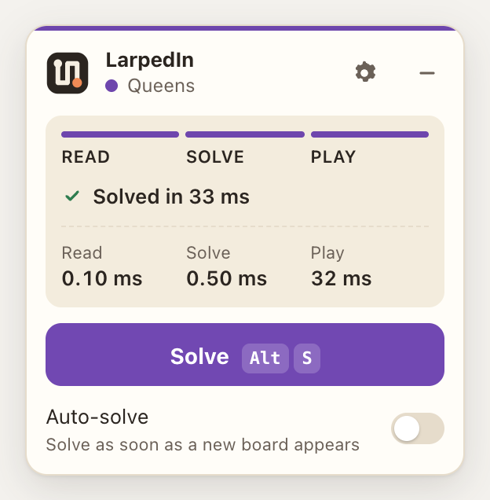

# LarpedIn

Reads, solves and plays LinkedIn's daily puzzles (**Zip**, **Queens**, **Tango**, **Patches**, and **Wend** as it lands) inside the page.

> LarpedIn is an independent fan project. It is **not affiliated with, endorsed by or connected to LinkedIn**.



## How it works

1. **Read:** every game is a React grid (`[data-testid="interactive-grid"]`). Each cell's
   component props hold the puzzle data, so reading is exact and takes about 0 ms:
   - Zip: `gridSize`, `sequenceNo` per cell (0-based, -1 = none), `walls` `[{cellIdx, direction}]`
   - Queens: `cellMeta.color` (region id)
   - Tango: `cellData.state` / `isLocked`, `edges` `[{startIdx, endIdx, isEqual}]`
   - Patches: `clueCells` `[{cellIdx, shapeConstraint, numberConstraint}]`, `gridRows`/`gridCols`
2. **Solve:** exact search solvers in `src/solvers/`. These are not ML, because the solvers are always
   correct and take milliseconds.
3. **Play:** synthetic mouse events on the grid. The handlers don't check `isTrusted`.
   - Zip: one drag along the path. A fallback mode focuses each cell and presses Enter.
   - Queens and Tango: tap cells until the right symbol shows.
   - Patches: drag corner to corner for each rectangle.

## Install

```bash
npm install && npm run build
```

The build writes one package per browser family:

- `dist/extension/`: Chrome, Edge, Brave, Opera. Open `chrome://extensions`, turn on
  **Developer mode**, click **Load unpacked** and pick the folder.
- `dist/firefox/`: Firefox desktop and Android (event-page background, AMO id). For a quick try,
  `about:debugging` > **Load Temporary Add-on**.
- `dist/safari/`: input for `sh scripts/safari.sh`, which needs full Xcode and makes a macOS + iOS app.
- `dist/store/`: the zips to upload to each store. [docs/PUBLISHING.md](docs/PUBLISHING.md) covers accounts, fees and review.
- `dist/larpedin.user.js`: a userscript for Tampermonkey (panel only).

A welcome page opens on install. Reload any LinkedIn tab that was already open.

## Usage

- **Panel.** On any `/games/*` page a small card appears bottom-left. Press **Solve** or **Alt+S**. It shows
  each stage (read, solve, play) and, when done, how long each took. On failure it says which stage failed
  and offers **Copy debug info** (JSON with the error, page, settings and the puzzle as read).
- Drag the card by its header; the position is remembered. **–** (or Esc) folds it into a pill; click the pill to open it.
- **Auto-solve** solves as soon as an unsolved board appears.
- The gear opens per-game settings (Zip input and drag path, Patches pace) and **Export puzzles**, which
  downloads every puzzle seen so far as JSON.
- **Toolbar popup:** status of the current tab, **Solve now**, links to each game, auto-solve and the shortcut.
  Settings sync between the popup, the welcome/options page and every LinkedIn tab.
- **Shortcut:** Alt+S (change it at `chrome://extensions/shortcuts`; the page also listens for Alt+S itself).

Everything runs in the browser: no account, no server, no analytics. Permissions: `storage` only, plus
content scripts on `https://www.linkedin.com/*`.

### How the pieces fit

| File | Runs in | Job |
|---|---|---|
| `src/page/main.ts` → `content.js` | page (MAIN world) | read / solve / play, draws the panel |
| `src/page/panel.ts` | page | the floating card, in a Shadow DOM so LinkedIn CSS can't touch it |
| `src/page/bridge.ts` → `bridge.js` | ISOLATED content script | relays settings (`chrome.storage.sync`) and status between page and extension via `postMessage` |
| `src/extension/background.ts` | service worker | opens the welcome page on install, relays the shortcut |
| `src/extension/popup.*`, `welcome.*` | extension pages | popup and welcome/options page |
| `src/page/theme.ts` | anywhere | the palette (base colours + one accent per game) and the logo SVG, for the website and video too |

Screenshots for the website: `npm run screenshots` (headless Chromium on local mock pages, writes
`docs/screenshots/`). Icons: `npm run icons` renders `src/extension/icons/` from the SVG in `theme.ts`.

## Dev

```bash
npm test            # solve every puzzle in fixtures/
npm run bench       # Zip stress test: node scripts/bench-zip.ts <size> <count> <numbers> <walls>
npm run typecheck
```

Add exported puzzles to `fixtures/` (same shape as `fixtures/2026-11-09.json`) to grow the test set.

## Status

Benchmarks on seeded random puzzles (`npm run bench`, `bench:queens`, `bench:tango`, `bench:patches`):

| | Read | Solve (median / worst) | Play on LinkedIn |
|---|---|---|---|
| Zip | checked on the live page | 8×8: 0.16 / 5 ms · 10×10: 0.7 / 34 ms | **untested** |
| Queens | checked | 7–11 (one answer): 0.01 / 0.05 ms | **untested** |
| Tango | checked; matches LinkedIn's own solution | 6×6: 0.01 / 0.04 ms | **untested** |
| Patches | checked | 6–9: 0.03 / 0.6 ms | **untested** |

To check a game in play: open a fresh puzzle, press Alt+S, and read the timing breakdown in the panel.
For Patches you can set the drag pace with `localStorage['lgs-patches-pace']` = `sync` | `task` | `frame`.

## Wend

Wend hides k words (e.g. 3, 5, 6 and 7 letters) in a letter grid with holes. Each word is a snake of
orthogonally adjacent tiles read from its first tile, and the words use every tile exactly once.

- **Read:** the word-list component (`[data-testid="wend-word-list"]`) has `puzzleLetters` (row-major,
  `""` = hole) and `solutionWords` (`[{sequencingIndex}]`). The word lengths come from the slots
  `wend-word-list-slot-<word>-<letter>`. If those are missing, the reader uses each cell's `letter` prop
  and the numbers in `wend-instructions`.
- **Solve** (`src/solvers/wend.ts`): it builds a trie of the dictionary words that fit the grid's letters,
  then walks self-avoiding paths with prefix pruning to list the candidate words. Then it finds an exact
  cover of the tiles with the required lengths, branching on the tile with the fewest candidates. When
  several covers exist, the cover with the most common words wins (cost = Σ (rank+1)²).
  If the dictionary finds nothing, or finds a cover that differs from the page's `solutionWords`, the
  solver plays the page's answer instead and logs a `[lgs] wend:` warning in the console.
- **Play:** drags each word cell by cell, then checks that its cells show `isLocked` (or
  `cell-#-locked-check`). If a word doesn't lock, the solver tries Enter per cell, then Space, then
  taps. It remembers the input that worked in `localStorage['lgs-wend-input']`. **Play is untested
  on the live page.**
- **Dictionary:** `src/data/wend-words.ts` is generated by `npm run dict:wend`
  (`scripts/make-wend-dict.mjs`) and committed, because the build imports it statically. It holds
  243,011 words (A–Z only, 3–12 letters), front-coded into 9 blocks by commonness rank, about 930 KB.
  Decoding takes about 25 ms on first use. Sources:
  - [SCOWL](http://wordlist.aspell.net/) size levels 10–70, via `wordlist-english`. Copyright 2000-2016
    Kevin Atkinson, under the SCOWL permissive licence (use, copy, modify and distribute with the
    copyright notice). The size level is the commonness rank (0–7).
  - `an-array-of-english-words` (MIT, Zeke Sikelianos; Letterpress word list), for words that SCOWL
    doesn't have. These get rank 8.
- **Bundle:** `dist/extension/content.js` is about 1.0 MB with the dictionary (about 85 KB without it).

`npm run bench:wend [count] [seed] [sizes] [maxRank]` runs on seeded random snakes. Results for 200
puzzles per size:

| Grid | Words | Solve median / p95 / max (words of rank ≤ 2) | Same, any word (rank ≤ 8) |
|---|---|---|---|
| 5×5 | 4 | 3.3 / 4.1 / 4.4 ms | 3.2 / 4.1 / 7.4 ms |
| 6×6 | 5 | 4.7 / 6.3 / 12 ms | 4.4 / 5.8 / 8.0 ms |
| 7×7 | 6 | 6.2 / 9.1 / 19 ms | 5.9 / 8.8 / 11.5 ms |

Most of that time goes to filtering the 243k words against the grid's letters. The fixture from
2026-11-09 solves to LinkedIn's own answer (ZAP, TREND, ACCEPT, RECEIPT) in about 5 ms. On random
puzzles, which are less constrained than LinkedIn's, the planted cover is returned 70–84% of the
time. The other covers are also valid.
